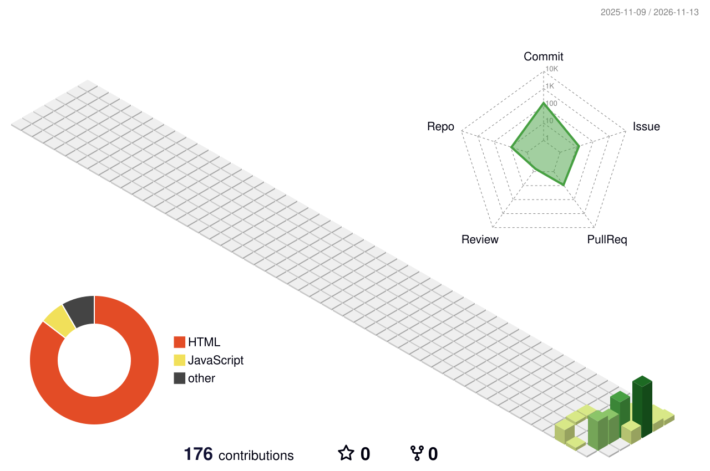

## Hi there 👋

<!--
**Cosonder/Cosonder** is a ✨ _special_ ✨ repository because its `README.md` (this file) appears on your GitHub profile.

Here are some ideas to get you started:
-->
- 🔭 I’m currently working on Gorenstein projective dg modules.
- 🌱 I’m currently learning dg categories, homological algebra and French.
- 👯 I’m looking to collaborate on Quiz (a language-learning website/app).
- 🤔 I’m looking for help with making a living.
- 💬 Ask me about Community.
- 📫 How to reach me: zhenhui.ding@imj-prg.fr
- 😄 Pronouns: he/him
- ⚡ Fun fact: why so serious?

<picture>
  <source media="(prefers-color-scheme: dark)" srcset="./assets/github-snake-dark.svg" />
  
</picture>

